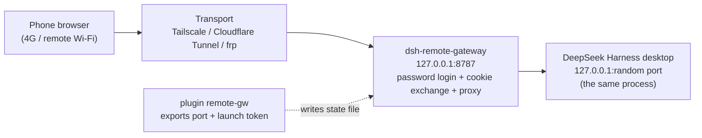
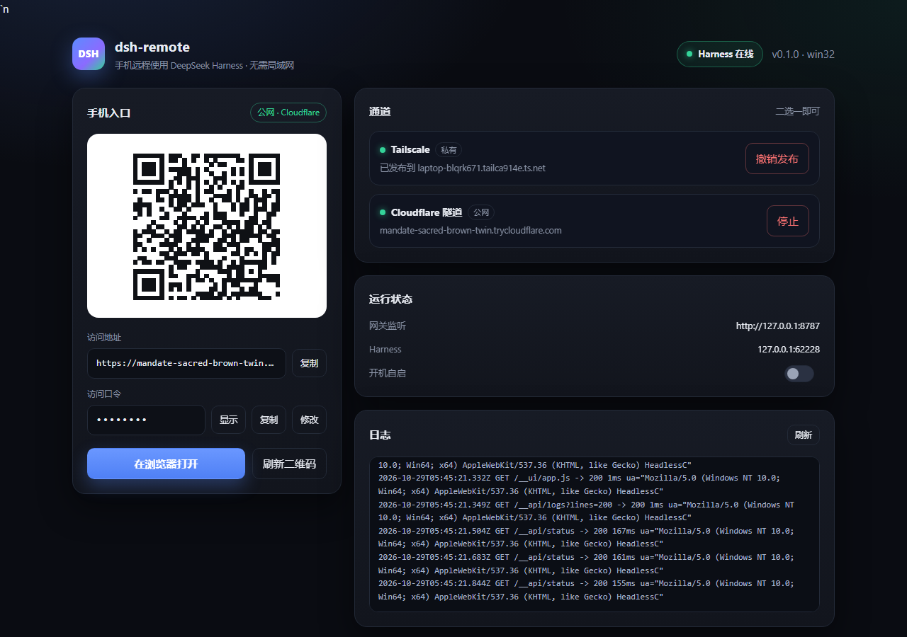

# dsh-remote — use DeepSeek Harness from your phone, anywhere

> Open the **DeepSeek Harness desktop app that is already running on your computer** from a phone on any
> network (4G/5G, office Wi-Fi, a café) — same process, same sessions, same tasks.
> **No LAN required, no port forwarding, no DSH source changes.**

English | [中文](README.md)

---

## The problem

The DeepSeek Harness desktop Web GUI binds to `127.0.0.1`, authenticates with a **per-process launch token**
and a signed cookie. From a phone you get `401 dsh web authentication required`.

`dsh-remote` adds three small pieces:

1. **A ~30-line plugin inside the Harness process** that writes the current `port` and `launch token` to a
   state file. The profile loader hot-mounts it — **no app restart**.
2. **A zero-dependency local gateway** (`gateway/server.mjs`): you log in with a password, the gateway
   exchanges the launch token for the Harness cookie and reverse-proxies HTTP + WebSocket to `127.0.0.1`,
   rewriting `Host`/`Origin` back to loopback so the Harness browser-trust fence accepts it.
3. **Any transport that works beyond the LAN**: Tailscale, Cloudflare Tunnel, ngrok, or your own VPS.



## Features

- **One harness, not a second instance** — no restart, no copied sessions.
- **Zero-dependency gateway** — Node built-ins only; `node server.mjs` is enough.
- **Password login** — scrypt hash, IP lockout after 10 failures, signed session cookies; the Harness
  cookie never leaves the gateway process.
- **WebSocket support** — session streams, task state and terminals flow through `/api/remote.mux`.
- **Old-browser compatibility layer** — patches APIs missing in Chromium 115 (some China-market WebViews)
  such as `Promise.withResolvers`.
- **Diagnostics** — client JS errors, failed resources and stuck requests are reported to the gateway log;
  ships a headless-Chromium probe (`probe-browser.mjs`).
- **Self-healing** — when the Harness restarts (new port + token), the gateway picks it up automatically.

## Desktop client and control panel



The gateway ships a local control panel at `http://127.0.0.1:8787/__ui/`. Three ways to open it:

- **One-click script (no install)**: `scripts\open-app.cmd` — opens it in Edge/Chrome **app mode**, a chromeless native-looking window;
- **Electron desktop client**: `cd desktop && npm install && npm start` — a real desktop app that also starts the gateway for you;
- **Any browser**: <http://127.0.0.1:8787/__ui/>.

What the panel does:

- status at a glance: harness online, gateway listener, autostart switch;
- phone entry: QR code, public URL, access password (reveal / copy / change);
- transports: publish/revoke Tailscale, start/stop the Cloudflare tunnel and get the new URL;
- logs: the last 200 gateway log lines, so you rarely need a terminal.

> The panel only accepts requests with a loopback Host header; tunneled traffic gets 403 — it
> cannot and should not be reachable from the internet.

## One-prompt setup (let your AI agent install it)

Paste this into your AI agent (DeepSeek Harness itself, Claude Code, Codex CLI, Cursor — anything with shell access). It installs the plugin, starts the gateway, publishes it over a non-LAN transport, renders the phone QR page and runs the 12-check selftest:

```text
Deploy https://github.com/h958661134/dsh-remote on this machine.
Clone the repo, then follow docs/agent-prompt.md exactly:
1) install the remote-gw plugin into the DSH desktop profile (back up cordis.patch.yml,
   wait for remote-gw-state.json);
2) run `node gateway/admin.mjs init` to create the password;
3) start gateway/server.mjs and confirm /__health returns ok:true;
4) ask me to choose Tailscale (private) or a Cloudflare tunnel (public), then run the matching
   script from scripts/;
5) render the phone access page and QR code;
6) `node gateway/selftest.mjs <password> <url>` must pass 12/12;
7) report the phone URL, password, transport, autostart status and the rollback command.

Constraints: do not modify the harness source, do not restart the desktop app (unless the plugin
did not hot-mount), keep listenHost at 127.0.0.1, never print the launch token, the dsh-auth
cookie or the password into public logs. On failure keep the state, report the commands, the
error and the last 30 lines of gateway/gateway.log.
```

Full version (English + Chinese, acceptance checks, pitfalls) — [docs/agent-prompt.md](docs/agent-prompt.md).

## Quick start (Windows)

Requirements: DeepSeek Harness desktop installed and running, Node.js ≥ 18, PowerShell 5.1+.

```powershell
git clone https://github.com/h958661134/dsh-remote.git
cd dsh-remote
powershell -ExecutionPolicy Bypass -File .\scripts\install.ps1
```

The installer copies the plugin into `%USERPROFILE%\.dsh\profiles\desktop\`, inserts the plugin row
(backing up `cordis.patch.yml`), creates `gateway/config.json` with a random password, starts the gateway on
`127.0.0.1:8787`, drops a **"手机访问.html"** page (QR + URL + password) on the Desktop, and registers an
autostart entry.

### Pick a transport

| Transport | Address | Account | When |
|---|---|---|---|
| **Tailscale** (recommended, private) | `http://<machine>.<tailnet>.ts.net/` | Tailscale account (free) | only your own devices, no public exposure |
| **Cloudflare quick tunnel** | `https://<random>.trycloudflare.com` | none | instant test; URL changes on restart |
| **Cloudflare named tunnel** | `https://dsh.example.com` | domain + Cloudflare | stable public URL |
| **ngrok free domain** | `https://xxx.ngrok-free.app` | ngrok account | stable URL without a domain |
| **Your VPS + frp/nginx** | your domain | a VPS | fastest, fully self-hosted |

Commands for each are in [docs/deployment.md](docs/deployment.md).

### Manual (any OS)

```bash
# 1) plugin: copy plugin/remote-gw.js into $DSH_HOME/profiles/desktop/ and append to cordis.patch.yml
#      - insert:
#          - id: remote-gw
#            name: ./remote-gw.js

# 2) gateway config (generates config.json + random password)
cd gateway && node admin.mjs init

# 3) run
node server.mjs

# 4) point Tailscale / your tunnel / your proxy at http://127.0.0.1:8787
```

## Configuration

| Field | Default | Meaning |
|---|---|---|
| `listenHost` | `127.0.0.1` | never set `0.0.0.0`; put Tailscale or a tunnel in front |
| `listenPort` | `8787` | listen port |
| `stateFile` | `~/.dsh/profiles/desktop/remote-gw-state.json` | written by the plugin |
| `auth.mode` | `password` | `password` or `none` (private Tailscale only) |
| `sessionMaxAgeDays` | `30` | phone session lifetime |
| `clientSupport` | `true` | inject compat layer + client diagnostics |
| `publicUrl` | empty | set `https://...` to mark cookies `Secure` |

```bash
node admin.mjs set-password <new-password>   # takes effect immediately
node admin.mjs show                          # secrets redacted
node server.mjs --check                      # state diagnostics (token redacted)
node selftest.mjs <password> <baseUrl>       # 12 end-to-end checks
```

## How it works

See [docs/architecture.md](docs/architecture.md). In short: the plugin exports the launch token; the gateway
exchanges it for the Harness `dsh-auth-*` cookie, rewrites `Host`/`Origin` to loopback, forwards the request
body (DSH RPC is POST-only), streams responses, and tunnels WebSocket upgrades.

## Security

The gateway listens on loopback only; access is gated by your own password; the Harness cookie stays in
memory; the launch-token state file is written with `0600`. When exposing through a public tunnel, use a
strong password and preferably an outer identity layer (Cloudflare Access, Tailscale). Details:
[docs/security.md](docs/security.md).

## Limitations

- Desktop profile only — `dsh web` already supports `--host/--trusted-host/--public-url` natively.
- The Harness app must be running (otherwise the gateway serves a "Harness not running" page).
- Quick-tunnel URLs change on restart.
- If Tailscale is relayed via DERP (hundreds of ms, low throughput), the ~1.7 MB frontend may not finish
  loading — use Cloudflare/ngrok/VPS instead.
- Cookies are bound to the loopback authority, so the gateway rewrites `Host`; you cannot front the Harness
  directly with a host-preserving reverse proxy.

## Layout

```
gateway/   zero-dependency gateway, control-panel UI (ui/), config tool, self-test, headless probe
desktop/   optional Electron shell (one window + gateway autostart)
plugin/    Harness desktop-profile plugin (exports port + launch token)
scripts/   Windows install/uninstall/doctor, Tailscale publish, tunnel refresh, QR/page generators
docs/      architecture, deployment, troubleshooting, security
examples/  transport configuration examples
```

## Troubleshooting

```powershell
powershell -ExecutionPolicy Bypass -File .\scripts\doctor.ps1        # check
powershell -ExecutionPolicy Bypass -File .\scripts\doctor.ps1 -Fix   # repair
```

See [docs/troubleshooting.md](docs/troubleshooting.md).

## License

[MIT](LICENSE)
