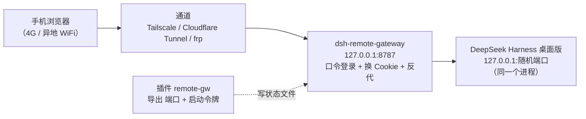

# dsh-remote — 手机远程使用 DeepSeek Harness

> 让你的手机在任何网络下（4G/5G、公司网、咖啡店）打开 **电脑上正在运行的那个 DeepSeek Harness**：
> 同一个进程、同一份会话、同一批任务，不是另起一套实例。
>
> 不需要局域网，不需要端口转发，不需要改 DSH 源码。

[](https://github.com/h958661134/dsh-remote/actions/workflows/ci.yml)
[](LICENSE)
[](gateway/package.json)
[](#%E6%89%8B%E5%8A%A8%E6%96%B9%E5%BC%8F%E4%BB%BB%E6%84%8F%E7%B3%BB%E7%BB%9F)


[English](README.en.md) | 中文

---

## 它解决什么问题

DeepSeek Harness 桌面版的 Web GUI 只监听 `127.0.0.1`，并用**每个进程随机生成的启动令牌 + 签名 Cookie** 做鉴权，
所以你在手机上直接访问会得到 `401 dsh web authentication required`。

`dsh-remote` 做三件小事：

1. **在 Harness 进程里挂一个 30 行的插件**，把当前的 `端口 + 启动令牌` 写到一个小状态文件里（热加载，**不用重启 App**）；
2. **在本机跑一个零依赖网关**：手机用你自己的口令登录，网关在后台用启动令牌换 Harness 的鉴权 Cookie，
   再把 HTTP / WebSocket 反向代理到 `127.0.0.1`，同时把 `Host`/`Origin` 改写回 loopback 以通过 Harness 的浏览器信任围栏；
3. **任选一条“不在局域网也能连”的通道**：Tailscale、Cloudflare Tunnel、ngrok 或你自己的 VPS。



## 特性

- **同一个 Harness**：不重启、不复制会话，手机看到的就是电脑上那个实例。
- **零依赖网关**：只有一个 `server.mjs`，只用 Node 内置模块，`node server.mjs` 就能跑。
- **自带登录口令**：scrypt 哈希、失败 10 次锁 IP 10 分钟、签名会话 Cookie，Harness 的 Cookie 不下发到手机。
- **WebSocket 全通**：会话流、任务状态、终端都走 `/api/remote.mux`，反代已支持 upgrade。
- **老浏览器兜底**：内置兼容层，补齐 Chromium 115 缺少的 `Promise.withResolvers` 等 API（OPPO/部分国产浏览器内核偏旧）。
- **可诊断**：手机端 JS 异常、资源加载失败、卡住的请求会回报到网关日志；附带无头浏览器探针 `probe-browser.mjs`。
- **自动跟随**：Harness 重启后端口/令牌变化，网关自动重新获取，无需人工干预。

## 桌面客户端与控制台


网关自带一个本地控制面板 `http://127.0.0.1:8787/__ui/`，三种打开方式：

- **一键脚本（推荐，零安装）**：`scripts\open-app.cmd` —— 用 Edge/Chrome 的「应用模式」打开，无地址栏、像原生窗口；
- **Electron 桌面客户端**：`cd desktop && npm install && npm start` —— 真正的桌面 App，会自动拉起网关并打开面板；
- **普通浏览器**：直接访问 `http://127.0.0.1:8787/__ui/`。

面板里能做的事：

- **状态一眼看清**：Harness 是否在线、网关监听地址、开机自启开关；
- **手机入口**：二维码、访问地址、访问口令（显示 / 复制 / 修改）；
- **通道管理**：一键发布/撤销 Tailscale，或启动/停止 Cloudflare 隧道拿到新地址；
- **日志**：网关最近 200 行日志，排错不用开终端。

> 控制面板只接受来自本机（loopback Host）的请求；经隧道进来的外部请求一律 403 —— 它不能也不该从公网访问。

## 一键 Prompt：让 AI Agent 帮你部署

把下面这段直接粘给你的 AI Agent（Harness 自己、Claude Code、Codex CLI、Cursor 都行），它会自动装插件、起网关、打通一条非局域网通道、生成手机二维码并跑完 12 项自检：

```text
请帮我在本机部署 https://github.com/h958661134/dsh-remote ：
clone 仓库后严格按 docs/agent-prompt.md 执行——
1) 安装 remote-gw 插件到 DSH desktop profile（先备份 cordis.patch.yml，等 remote-gw-state.json 出现）；
2) node gateway/admin.mjs init 生成口令；
3) 启动 gateway/server.mjs 并确认 /__health 的 ok:true；
4) 问我选 Tailscale（私有）还是 Cloudflare 隧道（公网），按 scripts/ 里对应脚本发布；
5) 生成手机访问页与二维码；
6) node gateway/selftest.mjs <口令> <地址> 必须 12/12；
7) 汇报手机地址、口令、通道类型、开机自启状态和回滚命令。

约束：不改 Harness 源码、不重启桌面 App（除非插件未热加载）、listenHost 保持 127.0.0.1、
不要把 launch token / dsh-auth Cookie / 口令贴到公开日志。失败时保留现场并报告
命令、错误输出和 gateway/gateway.log 最后 30 行。
```

完整版（含英文、逐步验收标准、常见偏差自查）见 [docs/agent-prompt.md](docs/agent-prompt.md)。

## 快速开始（Windows）

前置：电脑上已安装 **DeepSeek Harness 桌面版**（并保持运行）、Node.js ≥ 18、PowerShell 5.1+。

```powershell
git clone https://github.com/h958661134/dsh-remote.git
cd dsh-remote
# 管理员 PowerShell（仅 Tailscale 安装需要管理员；纯隧道模式可不用）
powershell -ExecutionPolicy Bypass -File .\scripts\install.ps1
```

`install.ps1` 会：

1. 检查 Node 与 Harness 的 profile 目录；
2. 把 `plugin/remote-gw.js` 装进 `%USERPROFILE%\.dsh\profiles\desktop\`，并在 `cordis.patch.yml` 里插入插件行（会先备份）；
3. 运行 `node gateway/admin.mjs init` 生成配置与**随机访问口令**；
4. 启动网关（只监听 `127.0.0.1:8787`），生成手机访问页与二维码到桌面；
5. 安装开机自启（启动文件夹里的 VBS）。

完成后桌面会出现 **「手机访问.html」**（含二维码、地址、口令）。

### 选一条通道

| 通道 | 地址形态 | 是否需要账号 | 适合 |
|---|---|---|---|
| **Tailscale**（推荐，私有） | `http://<机器名>.<tailnet>.ts.net/` | 需要 Tailscale 账号（免费） | 只想自己设备能连，不暴露公网 |
| **Cloudflare 快速隧道** | `https://<随机>.trycloudflare.com` | 不需要 | 马上试通；地址每次重启变化 |
| **Cloudflare 命名隧道** | `https://dsh.你的域名.com` | 需要域名 + Cloudflare | 固定地址、长期使用 |
| **ngrok 免费域名** | `https://xxx.ngrok-free.app` | 需要 ngrok 账号 | 固定地址、不想买域名 |
| **自建 VPS + frp/nginx** | 你的域名 | 需要 VPS | 最快最稳、完全自控 |

具体命令见 [docs/deployment.md](docs/deployment.md)。

### 手动方式（任意系统）

```bash
# 1) 插件：把 plugin/remote-gw.js 放进 Harness 的 desktop profile 目录
#    $DSH_HOME/profiles/desktop/  （Windows 默认 %USERPROFILE%\.dsh\profiles\desktop）
#    然后在该目录的 cordis.patch.yml 末尾追加：
#      - insert:
#          - id: remote-gw
#            name: ./remote-gw.js

# 2) 网关配置
cd gateway
node admin.mjs init          # 生成 config.json 并打印随机口令

# 3) 启动
node server.mjs

# 4) 手机访问：把任何隧道/反代指到 http://127.0.0.1:8787
```

## 配置

`gateway/config.json`（由 `admin.mjs` 生成）：

| 字段 | 默认 | 说明 |
|---|---|---|
| `listenHost` | `127.0.0.1` | 网关监听地址。**不要改成 `0.0.0.0`**，用 Tailscale/隧道在前端接入 |
| `listenPort` | `8787` | 监听端口 |
| `stateFile` | `~/.dsh/profiles/desktop/remote-gw-state.json` | 插件写出的状态文件 |
| `auth.mode` | `password` | `password` 或 `none`（仅限完全私有的 Tailscale 场景） |
| `sessionMaxAgeDays` | `30` | 手机登录有效期 |
| `clientSupport` | `true` | 注入兼容层 + 客户端诊断上报 |
| `publicUrl` | 空 | 若通过 HTTPS 访问，填 `https://...` 让会话 Cookie 带 `Secure` |

常用命令：

```bash
node admin.mjs set-password 新口令   # 修改口令（立即生效）
node admin.mjs show                  # 查看配置（口令与密钥已隐藏）
node server.mjs --check              # 打印状态（令牌已打码）
node selftest.mjs 口令 <baseUrl>      # 12 项端到端自检
```

## 它是怎么工作的

1. **插件**：Harness 的 profile loader 支持热加载；`remote-gw` 被挂载后读取 `ctx.webServer.port` 与
   `ctx.connection.authenticatedUrl(origin)`，把带启动令牌的 URL 原子写入 `remote-gw-state.json`。
2. **换 Cookie**：网关用 `GET /?token=...` 向 Harness 换取 `dsh-auth-*` 签名 Cookie（30 天有效），缓存在内存中；
   遇到 401 会自动重取一次。
3. **反代**：所有请求把 `Host`/`Origin` 改写为 `127.0.0.1:<port>`（这是通过 Harness 浏览器信任围栏的关键），
   注入 Harness Cookie，然后把响应流式转发；WebSocket 用原始 socket 透传。
4. **不丢 body**：DSH 的 RPC 全是 POST，网关会缓冲请求体（≤16MB）后转发，支持 401 重试；大文件上传走流式。
5. **兼容层**：对 HTML 响应注入一段脚本，补齐旧 WebView 缺失的 API，并上报客户端异常。

更细的调用链、信任围栏判定、Cookie 属性见 [docs/architecture.md](docs/architecture.md)。

## 安全说明

- 网关默认只监听回环地址，公网/局域网都由前面的 Tailscale 或隧道负责接入。
- 手机登录用的是**你自己的口令**（scrypt 加盐哈希），不是 Harness 的 Cookie。
- Harness 的 `dsh-auth-*` Cookie **不落盘、不发手机**，只存在网关进程内存里。
- 启动令牌会写入 `remote-gw-state.json`（仅当前用户可读，`0600`）。该文件等价于本机凭证，不要提交或分享。
- 通过公网隧道暴露时：务必使用强口令；优先用 Cloudflare Access / Tailscale 做外层身份校验；
  详见 [docs/security.md](docs/security.md)。

## 已知限制

- **只支持桌面版（desktop profile）**：`dsh web` 自己就有 `--host/--trusted-host/--public-url`，不需要本项目。
- **Harness 必须运行**：App 关闭时网关返回「Harness 未运行」页。
- **快速隧道地址会变**：`trycloudflare.com` 每次重启换域名，桌面页可用 `scripts/refresh-tunnel.ps1` 刷新。
- **Tailscale 可能被中继**：若两端无法打洞，流量会走 DERP 中继（可能几百毫秒 + 低吞吐），
  1.7MB 的前端资源可能加载不完 —— 这种情况改用 Cloudflare/ngrok/VPS 通道。
- **Cookie 绑定 loopback 权威**：网关必须把 `Host` 改回 `127.0.0.1:<port>`，因此**不能**直接在前面套一个保留原 Host 的反代去直连 Harness。

## 目录结构

```
gateway/        零依赖网关（server.mjs）、控制面板 UI（ui/）、配置工具、自检、无头探针
desktop/        Electron 桌面客户端（可选，一个窗口 + 自动拉起网关）
plugin/         Harness 桌面 profile 插件（导出端口 + 启动令牌）
scripts/        Windows 一键安装/卸载/体检、Tailscale 发布、隧道刷新、二维码/访问页生成
docs/           架构、部署、排错、安全
examples/       各通道的配置示例
```

## 排错

先跑体检：

```powershell
powershell -ExecutionPolicy Bypass -File .\scripts\doctor.ps1        # 只检查
powershell -ExecutionPolicy Bypass -File .\scripts\doctor.ps1 -Fix   # 自动修复
```

常见现象与原因见 [docs/troubleshooting.md](docs/troubleshooting.md)：

| 现象 | 常见原因 |
|---|---|
| 手机白屏 / 卡在 Loading plugins | 老内核缺 API（兼容层可解）或通道太慢（DERP 中继） |
| 页面能开但会话/任务为空 | 网关版本旧（POST body 未转发），升级后正常 |
| `Harness 未运行` | 桌面 App 没开，或插件没装 |
| 401 / 登录页反复出现 | 口令错误，或 Cookie 被清 |
| 手机打不开地址 | Tailscale 没开 / 隧道没起 / DNS |

## 贡献

欢迎 issue / PR：新的通道示例（frp、nginx、Caddy）、Linux/macOS 安装脚本、更多浏览器兼容性验证。

## License

[MIT](LICENSE)
